# Code Breaker

A local web app for learning, making and breaking codes. It covers 70 cipher systems from the Spartan scytale to AES, interactive machines, the theory behind codebreaking, and real attempts on unsolved ciphers, with every claim tested against controls. It also reads signals from devices, files and living things: raw camera frames, logic-analyser captures, birdsong and more.

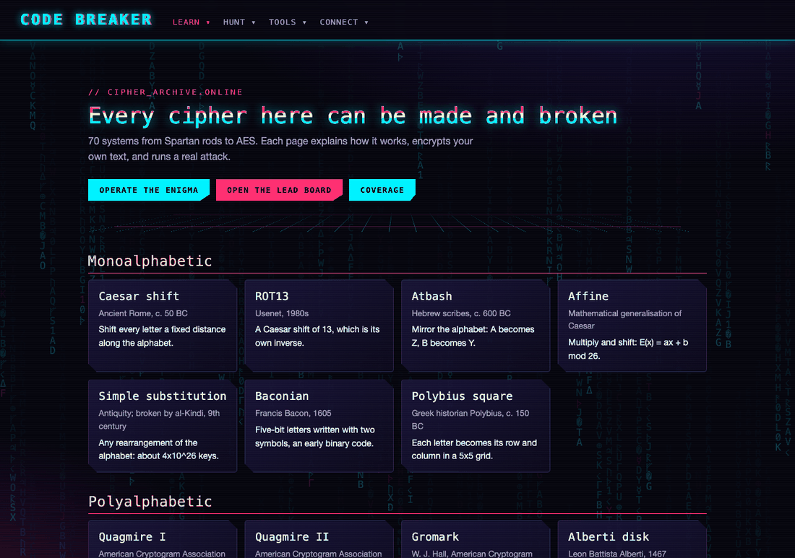

> **Honesty first.** No famous unsolved cipher has been cracked here. Results count only when they beat a positive control, a shuffled null comparison and a check that the output reads as text. Candidate readings are labelled as candidates.

## Quick start

```bash
python -m venv .venv && .venv/bin/pip install -r requirements.txt
.venv/bin/python run.py          # then open http://127.0.0.1:8000
PYTHONPATH=. .venv/bin/python -m pytest -q tests/
```

Everything runs on this computer. Models for bird and sound identification (BirdNET, YAMNet) download on first use into local folders that are not committed.

## What it does

### Learn

- **Library of 70 cipher systems**, each with an explanation, an encryptor and, for 49 of them, a working attack. Classical, ACA types, machines such as Enigma and the M-209, and modern cryptography with worked attacks on its misuse.
- **Machines and How It Works**: an Enigma you can type on, a bombe, the Lorenz machine, Colossus, AES, Feistel networks, RSA and Diffie-Hellman, each animated step by step.
- **Theory**: 17 topics in information theory, inference and cryptanalysis, each with a simulation: entropy, Huffman coding, randomness tests, LFSRs and Berlekamp-Massey, Monte Carlo and MCMC, belief propagation, hidden Markov models, variational inference, Shor's algorithm, differential cryptanalysis, Pollard's rho, and **error correction** (parity, CRCs, check digits, Hamming codes, Reed-Solomon, convolutional codes with Viterbi decoding, Shannon's limit).
- **Maths**: 14 topics with tested worked examples. **History**: a timeline of 37 events.
- **Codes in Nature**: the genetic code, CRISPR, chemical messages, firefly flash codes, alarm calls, whale song, electric fish, honest signalling and more, each with how the information is encoded.
- **Recovering Data**: why reading the source accurately comes first, with measured OCR comparisons, image reconstruction with known answers, and key-aware repair.

| Enigma, rotor by rotor | Error correction against Shannon's limit |
|---|---|
| 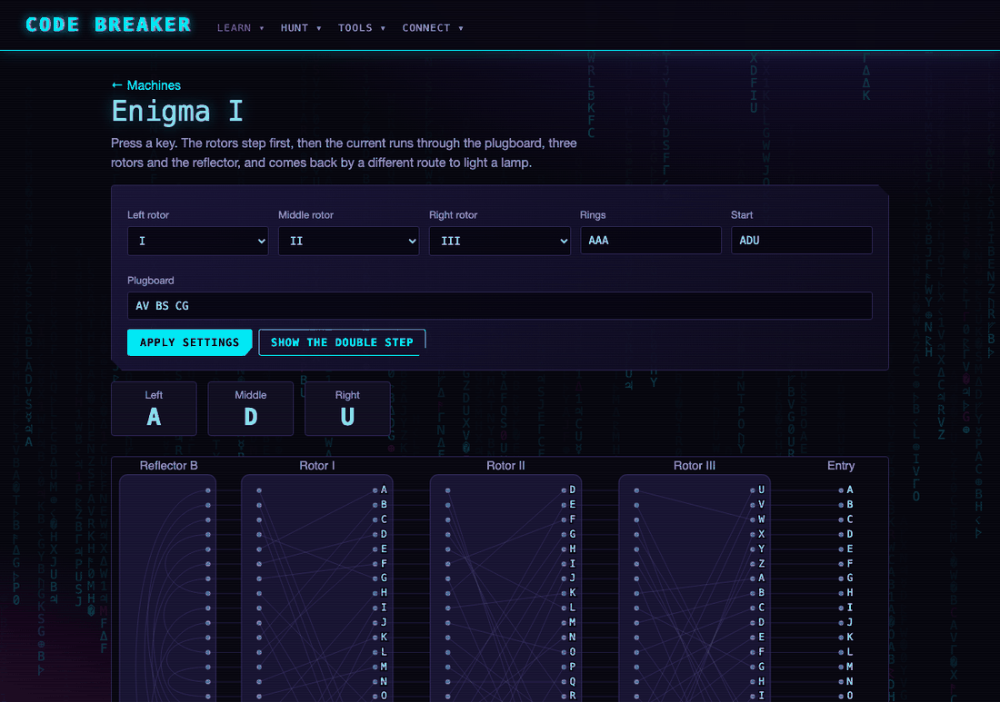 | 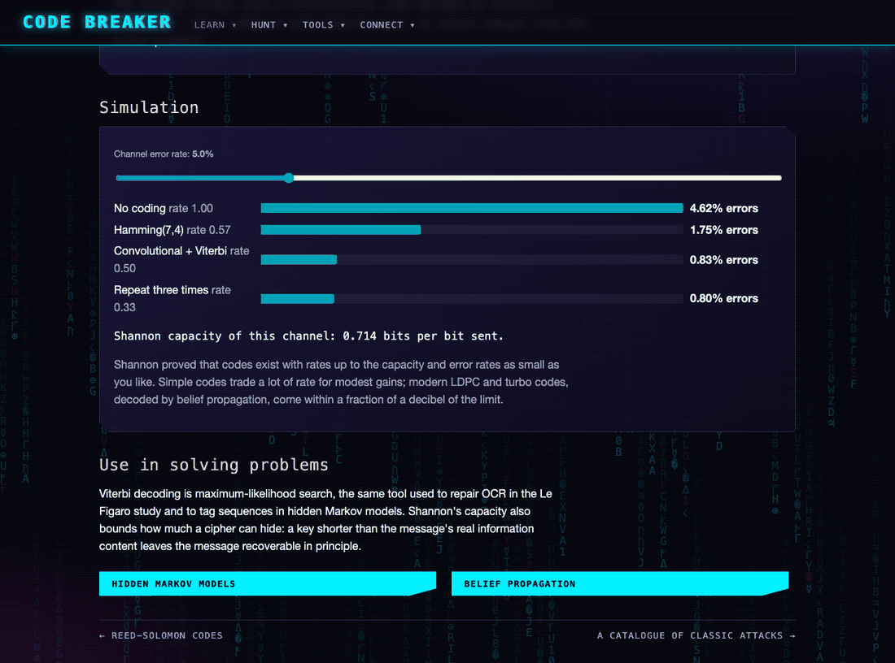 |

### Break

- **Workbench**: paste any ciphertext and *Crack it*. Every stage is shown: the text, statistics, rule-based and neural guesses at the system, worked traces (frequency analysis, all Caesar shifts, Vigenère columns, annealing), then all 49 attacks across six languages within a time limit. Encodings such as Base64 are peeled in layers. The best reading is tested against shuffled text, and short texts are not trusted beyond their unicity distance. In the recorded benchmark of one 400-letter text per cipher, 48 of 49 were recovered with no wrong "readable" verdicts; the one miss (Quagmire III) has since been fixed.
- **Codes the Workbench cannot read** can be sent to the hunter, which keeps working on them with more time at each pass.

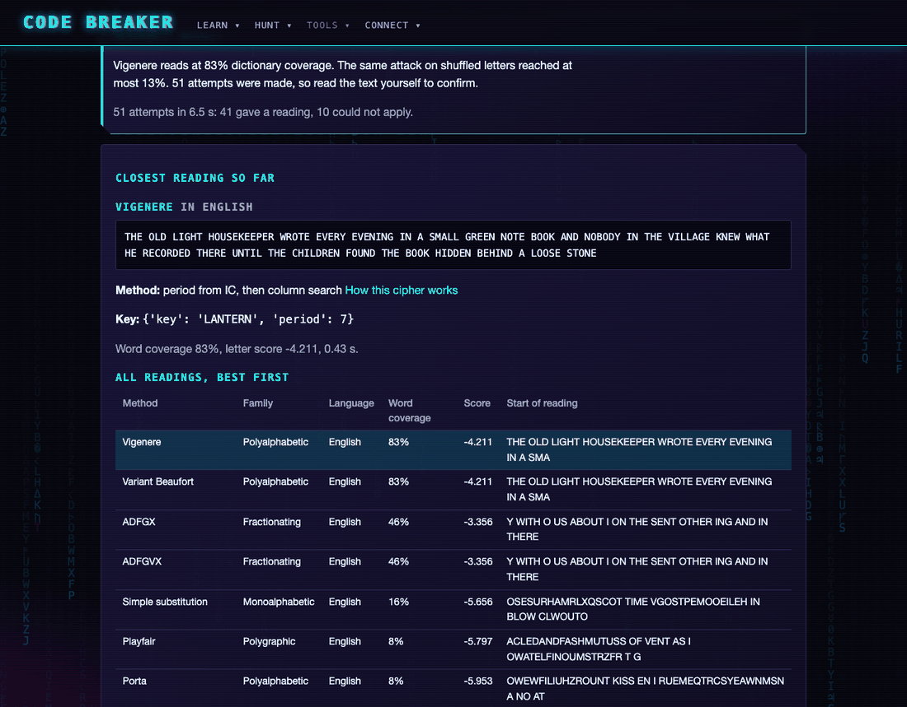

### Hunt

- **Mystery Lab**: 22 case files, including Beale, Dorabella, Kryptos K4, the Voynich manuscript, the Zodiac ciphers, the Tamam Shud code, Liber Primus, Rongorongo, Linear A and the Le Figaro personal-column ads.
- **Lead Board and Solutions**: a database of 276 tracked codes with facts, leads, avenues and 14,673 logged attempts by the hunter, which runs the least-explored avenues and escalates effort over time.
- **Le Figaro ads, 1875 to 1900**: OCR of the scans, fusion of two OCR engines with a French language model, the writers' documented substitution and digit tables, a dictionary beam search for letter-digit ads, and a dictionary code on an 1860 French dictionary. 52 candidate readings are recorded, 35 of them checked against the scan by eye, including what appears to be one couple's correspondence from 1883 to 1887. Whether any are new to the database maintainer has not been checked. `docs/review_queue.md` lists every candidate awaiting review by family and strength of evidence.

| A correspondence read under one writer's table | Candidate readings, sorted by how far each can be trusted |
|---|---|
| 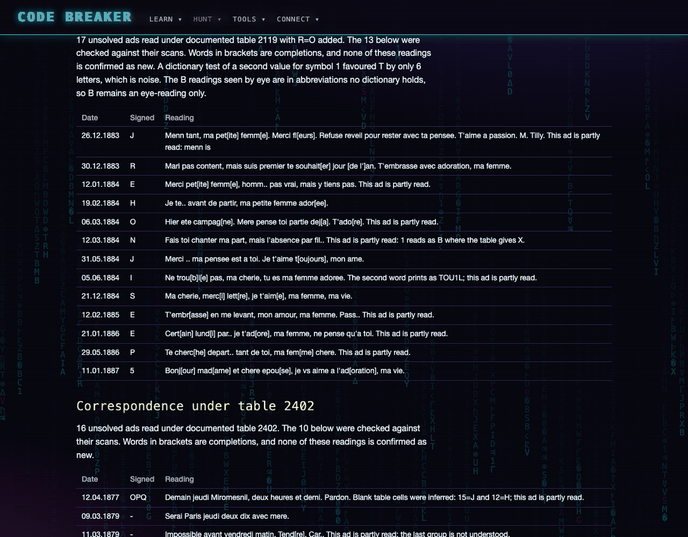 | 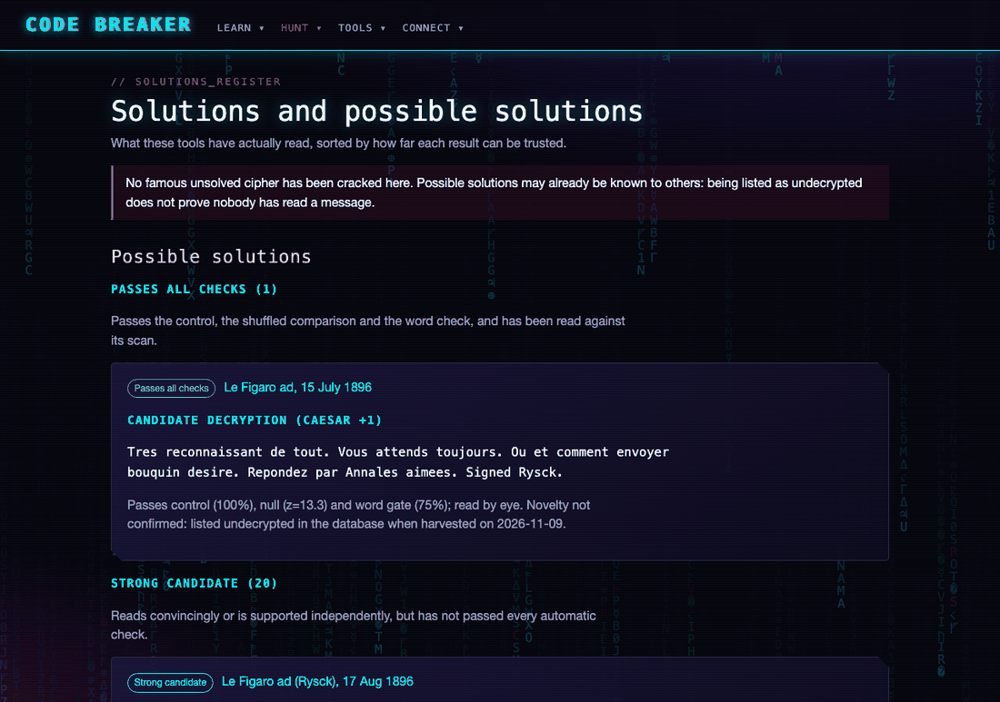 |

### Signals, devices and files

- **Signal Workbench**: rebuild raw camera and sensor frames from bare bytes. It finds the row length and the pixel format (8 and 16-bit, RAW10, RAW12, Kinect 11-bit packed depth, YUYV, RGB24, RGB565, Bayer). On generated frames, 75 of 80 are found exactly, and the page shows the reliability of each format.
- **Logic Analyser**: decode sampled wires as UART, SPI, I2C, CAN or 1-Wire, with speed, parity, polarity, SPI mode and wiring found automatically. Protocols are ranked by how hard their own checks are to pass by chance, such as CAN's CRC-15. Generated captures with glitches decode 50 of 50, on both the tuning set and a fresh one. CSV exports from sigrok or Saleae can be opened.
- **Live Devices**: lists attached USB devices, cameras, audio, displays, Bluetooth, serial ports and network interfaces, and monitors their data read-only: serial streams with format recognition (GPS sentences with checksums, JSON, sensor readings, binary packets), camera and microphone analysis in the browser, and network throughput. Simulated devices allow trying it without hardware.
- **File Inspector**: identify and open any file by its magic bytes rather than its name, with a security scan, a format database, previews (images, tables, archives, SQLite, NumPy, MATLAB, Parquet, HDF5, NetCDF, Excel, PDF, certificates, WAV), an entropy map, readable strings and a search for files hidden inside.
- **Barcodes & QR**: how barcodes, QR codes and their relatives work; make 14 kinds, read them from a picture or the camera, see a QR code's parts, and measure how much damage each error-correction level survives.
- **Sound Lab**: birdsong as a code. A recording becomes a spectrogram, a sequence of syllable types and its entropy; BirdNET suggests the species and YAMNet the kind of sound.

| Kinect depth rebuilt from raw bytes | CAN bus decoded with CRC checks |
|---|---|
| 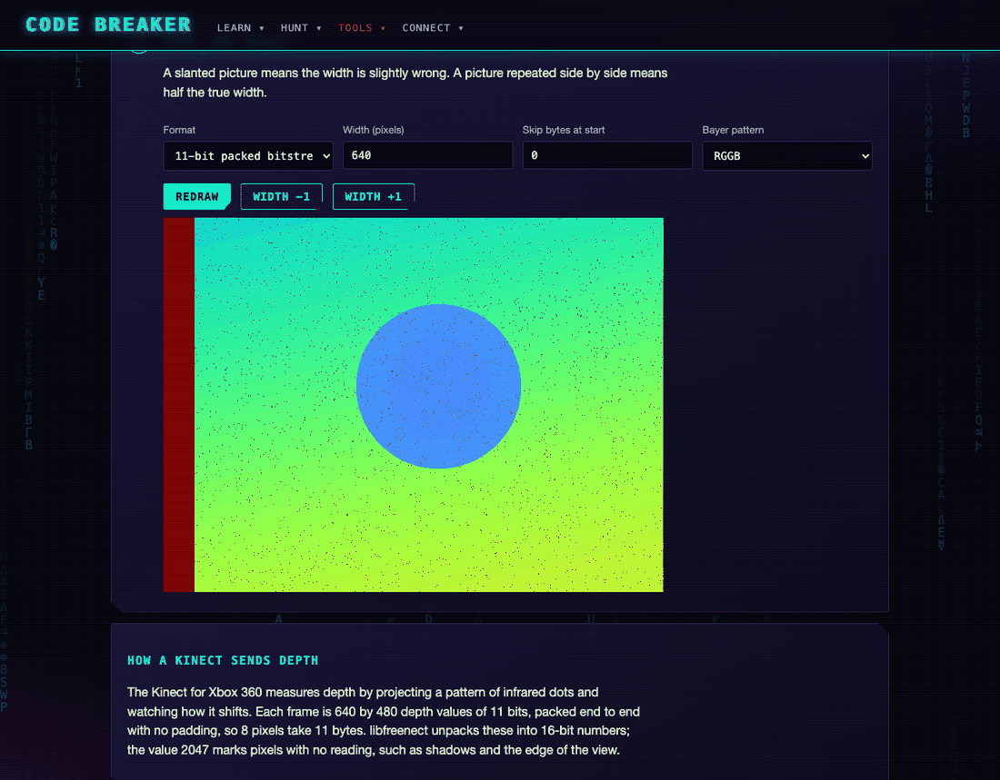 | 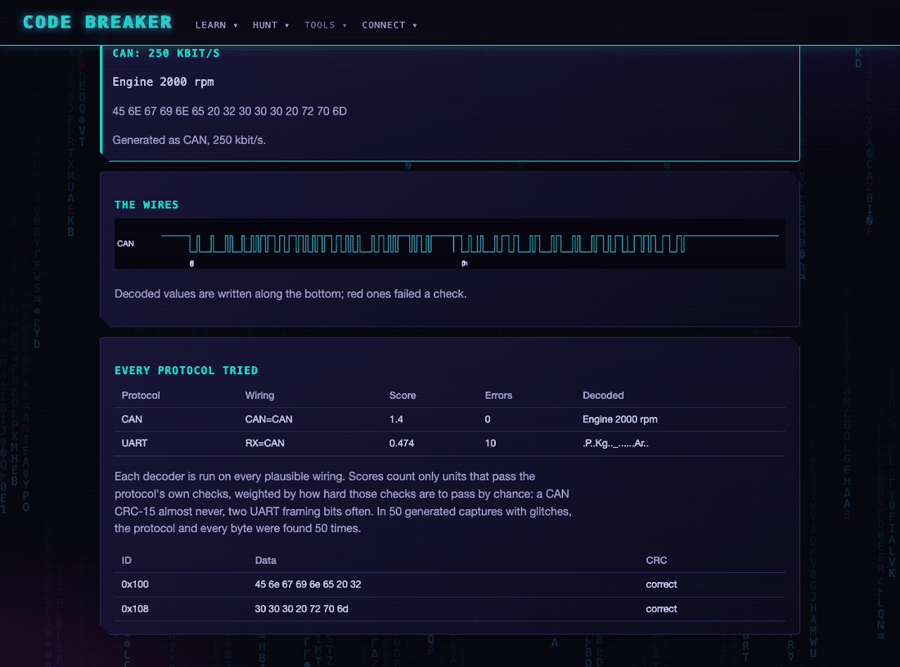 |

| Birdsong as a sequence, with species candidates | A PNG hidden inside an unknown binary |
|---|---|
| 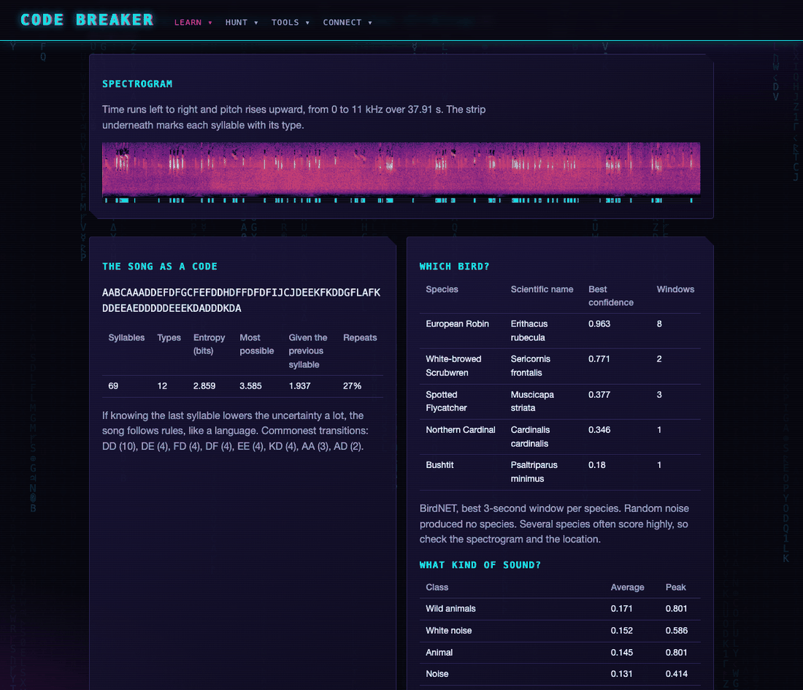 | 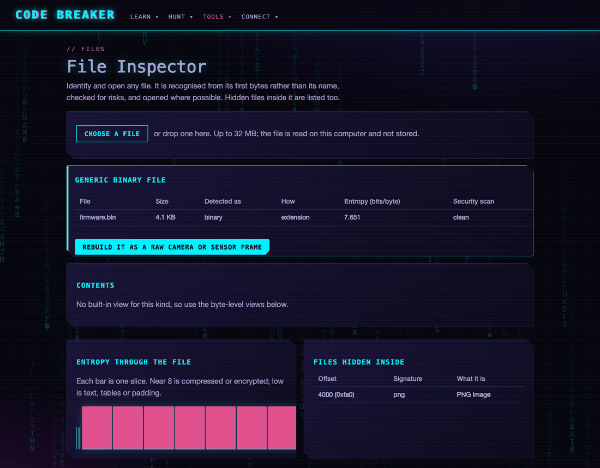 |

| Simulated GPS on the serial monitor | Image reconstruction with known answers |
|---|---|
| 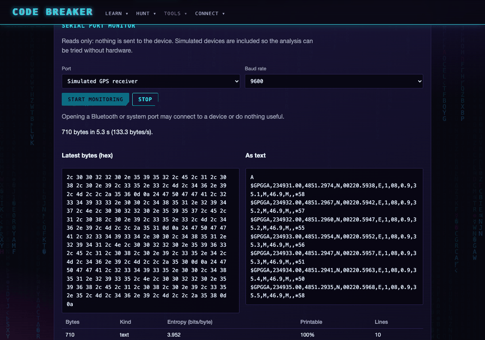 | 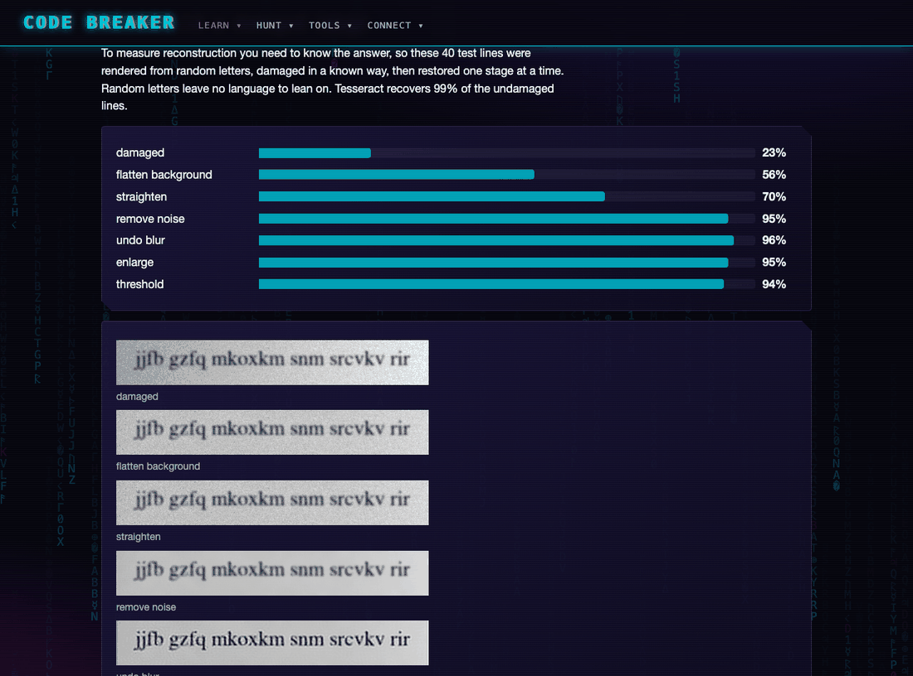 |

### Puzzles and more

A 3D Rubik's cube with a solver and camera reading, sudoku from a photo, Mastermind, Lights Out, sliding tiles, Hanoi, N-Queens, Knight's Tour and nonograms, with illustrated step-by-step guides. Also translation (including a rough Latin model), challenges, community links and a searchable index of publications.

| Rubik's cube | Codes in Nature |
|---|---|
| 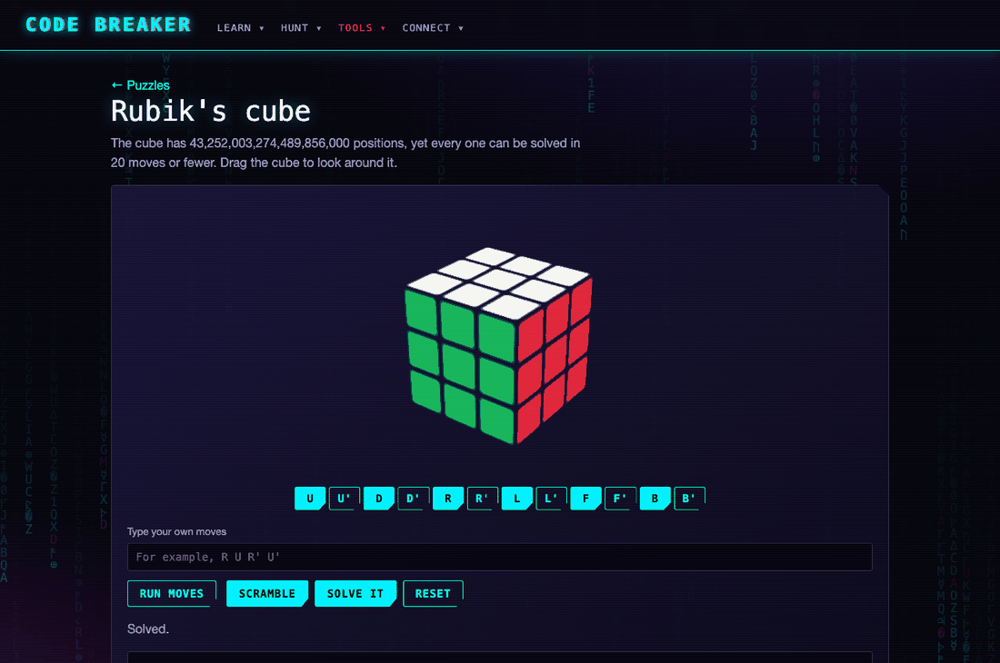 | 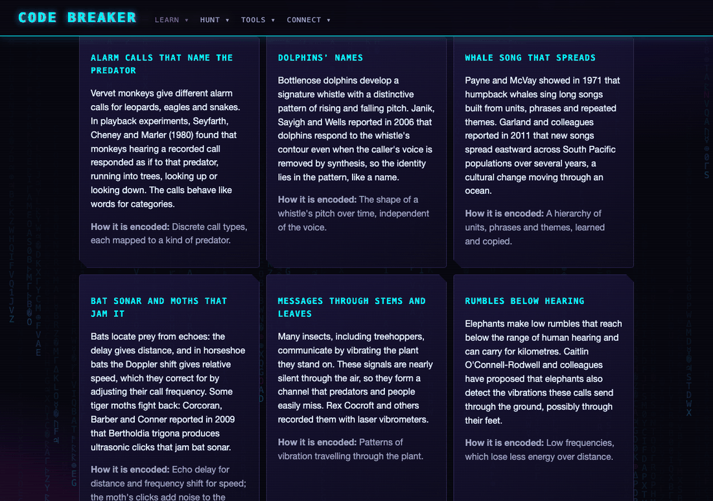 |

## How results are judged

A reading is reported as solved only if it passes three gates (`codebreaker/validation.py`):

1. **Positive control**: the same method, on a known message of the same length and type, recovers it.
2. **Null comparison**: the real ciphertext scores far better than shuffled copies, with the bar raised for the number of hypotheses tried.
3. **Reads as text**: the output contains real words at a rate close to a genuine solve.

New tools follow the same rule: every decoder in the Signal Workbench, Logic Analyser and Sound Lab is measured on generated data with known answers, and the measured success rate is shown on the page.

## Layout

| Path | Contents |
|---|---|
| `codebreaker/ciphers/`, `attacks/` | Cipher systems and attacks |
| `codebreaker/mysteries/` | Case files, the hunter, the Le Figaro and AIM work |
| `codebreaker/crack*.py`, `submissions.py` | The Workbench pipeline and submissions to the hunter |
| `codebreaker/signals/` | Raw frames and the Logic Analyser |
| `codebreaker/devices/` | Live device discovery and streams |
| `codebreaker/files/` | File identification, readers and carving |
| `codebreaker/sound/` | Sound Lab |
| `codebreaker/web/` | FastAPI app and the single-page front end |
| `data/` | Sources, results and the leads database |
| `tests/` | 371 tests |

`INTERFACE.md` is the full navigation map, `ROADMAP.md` the plan and lessons learned, and `SESSION_LOG.md` the history.

## Credits and sources

- File identification, the format database, the security scanner and several readers are adapted from the author's **textview** project; BirdNET use follows the author's **bird_sound_analyzer** project.
- Le Figaro ads and writers' tables: Didier Müller's database (apprendre-en-ligne.net) and Dunin, Schmeh and Müller (HistoCrypt 2024). AIM dictionary: Napoléon Landais, *Petit dictionnaire des dictionnaires français*, 1860, via archive.org.
- Unsolved cipher transcriptions: the AZdecrypt collection and the sources listed on each case page.
- **BirdNET** 2.4 (Cornell Lab of Ornithology and Chemnitz University of Technology) is licensed for non-commercial use. **YAMNet** is by Google.
- Reference bird recordings are from Wikimedia Commons under CC BY-SA, with sources in `data/sources/sounds/sources.json`.

This is a private project for personal study.
